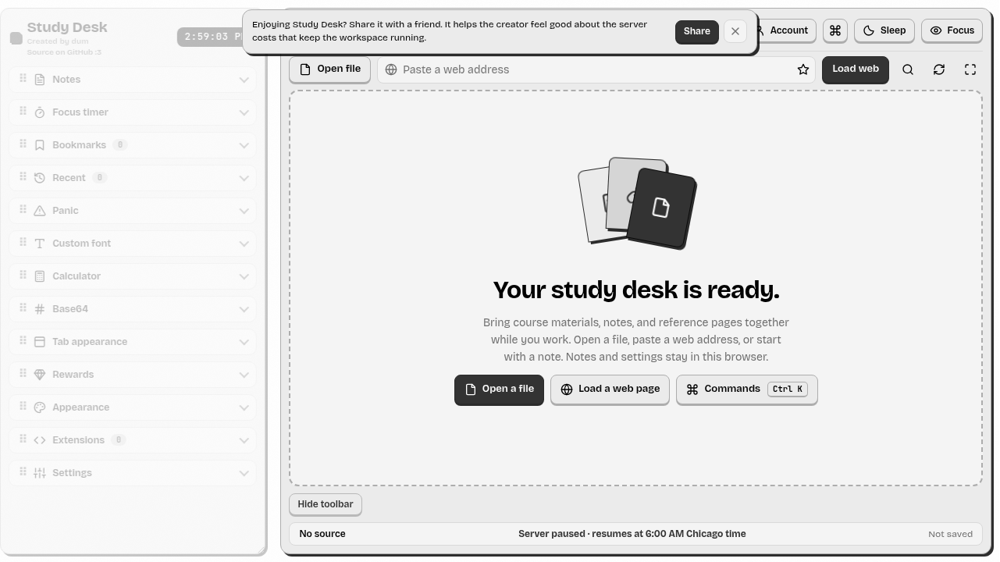

# File Opener | Workspace

Study desk is aimed to provide a functional and workspace for ChromeOS users, especially for educational purposes.

Even though this is aimed to educational students, it doesnt mean that it can also be used for other things.

# Why create HTML that executes a lengthy Base64 string?
The Base64 GitHub release allows you to run the file opener in almost any location, such as mimo.org.
Mimo.org is known for its inability to update if the code is considered too complex. However, the Base64 code bypasses this limitation.

# Did you use AI for the README.md?
Yes, I did. I utilized the built-in “Apple Intelligence” feature that modern iPhones have, rather than relying on a cloud-based LLM. This approach ensures that the AI processing is done locally, saving water resources.

