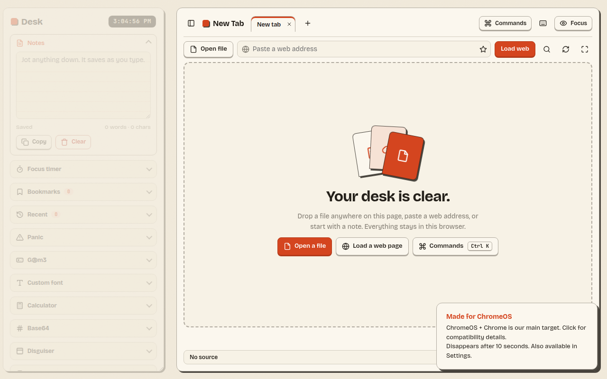

# File Opener | Workspace

*Ignore my dog ahh*

This site aims to provide a functional workspace for ChromeOS users, particularly for educational purposes.

# Why create HTML that runs a long Base64 string?
The Base64 GitHub release allows you to run the file opener in almost any location, such as mimo.org.

Mimo.org is known for its inability to update if the code is considered too complex. However, the Base64 code bypasses this limitation.

# Did you use AI for the README.md?
Yes, I did. Not the cloud LLM, but rather the built-in “Apple Intelligence” that modern iPhones have. This means I ran the AI locally instead of wasting gallons of water.